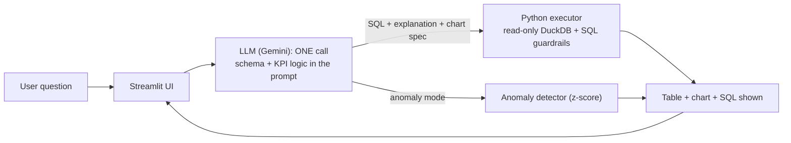

# 🏭 Industrial Data Assistant

> Ask your production data questions in plain French or English. Get KPIs, charts, anomaly alerts and weekly reports. Every number is computed by code, never invented by the model.

**Résumé (FR)** : agent conversationnel (Python, LLM Gemini, DuckDB, Streamlit) qui interroge des données de production **simulées** en langage naturel : calcul de KPI (TRS/OEE, rebuts, OTD...), graphiques Pareto et tendances, détection d'anomalies et rapport hebdomadaire PDF. Chaque réponse affiche la requête exécutée.

## Why this project

In industry, production data (downtime, scrap, OEE, late orders, stock) is scattered across Excel files and tools, and managers spend time building dashboards by hand. This project explores a safer way to put an LLM on top of such data: **the model writes the query, Python executes it, and the numbers always come from an executed calculation.**

## Features

- 💬 Natural-language questions in **French and English**, with follow-up questions (conversation memory)
- 📐 Documented KPIs: OEE/TRS, availability, performance, quality, scrap rate, downtime, OTD, service level
- 📊 On-demand charts: Pareto of downtime causes, trends, histograms
- 🚨 Anomaly detection (daily value more than 2 standard deviations from the mean, plus 30-day drift)
- 📄 Weekly report exportable as **PDF and Markdown**
- 🔍 Every answer shows the **SQL actually executed** (transparency)

## Architecture



1. The LLM receives the database **schema**, the **KPI formulas** (as SQL) and the last 4 exchanges (compact context).
2. In a **single forced function call**, it returns a SQL query, a short explanation (written *before* seeing results, so it contains no figures) and the chart to draw.
3. Python validates the query (SELECT only, forbidden keywords blocked, read-only connection), runs it, and displays the result.
4. If the SQL fails, the model gets the error once and corrects it.

The model never sees the data before writing the query, so it cannot invent a number.

## Quick start

Requires Python 3.11+ and a free [Google AI Studio](https://aistudio.google.com) API key.

Clone or download this repository (green **Code** button on GitHub), then in a terminal:

1. `cd industrial-data-agent`
2. `python -m venv .venv && source .venv/bin/activate` (Windows: `.venv\Scripts\activate`)
3. `pip install -r requirements.txt && python src/generate_data.py && cp .env.example .env` (Windows: `copy .env.example .env`)
4. Open `.env` and paste your key in `GEMINI_API_KEY`
5. `streamlit run app.py`

The simulated dataset (~55,000 rows, Jan-Sep 2026) is generated locally with a fixed seed.

> Windows tip: if `pip.exe` is blocked by Smart App Control, use `python -m pip install -r requirements.txt`.

## Example questions

| Question | What happens |
|---|---|
| Quelle ligne a le pire TRS ce mois ? | KPI by line, sorted, SQL shown |
| Montre le Pareto des causes d'arrêt de L2 | Pareto chart |
| Y a-t-il des anomalies de rebuts sur L3 ? | Anomaly detector (finds the injected March scrap spike) |
| Et sur L5 ? | Follow-up using conversation memory |
| What is the on-time delivery rate for each product? | Answer in English |

## KPI definitions

All ratios are computed on **sums first, then divided** (never an average of ratios).

- Availability = (opening time − downtime) / opening time
- Performance = pieces produced / (run time × theoretical rate)
- Quality = good pieces / pieces produced
- **OEE (TRS) = Availability × Performance × Quality**
- Scrap rate = scrapped pieces / pieces produced
- OTD = orders delivered on time / orders · Service level = delivered quantity / ordered quantity

## Design decisions

- **Single LLM call per question** (text-to-SQL) instead of a multi-step tool loop: faster and cheaper. The earlier tool-calling version is kept in `src/agent_v1.py` for comparison.
- **Safety**: read-only DuckDB connection, SELECT/WITH only, blacklist (DROP, COPY, read_csv...), one statement, result size capped.
- **Reliability**: KPI formulas are written once in the prompt and implemented independently in `src/kpi.py`; the evaluation compares the agent with references computed separately in pandas.
- **Free-tier friendly**: request timeout and automatic retry/fallback model, configurable via `.env`.

## Evaluation

Reference answers are computed **independently in pandas** from the CSV files (not with the agent's SQL, nor with `kpi.py`). Run it yourself: `python src/eval_agent.py` (30 reference questions) and `python src/eval_validation.py` (10 questions never used to tune the prompt).

| Test set | Questions | Accuracy | Median response time |
|---|---|---|---|
| Reference set, run 1 | 30 | 29/30 (97 %) | 2.0 s |
| Reference set, run 2 | 30 | 28/30 (93 %) | 1.9 s |
| Validation set (unseen questions) | 10 | 10/10 (100 %) | about 2 s |

- Model: `gemini-3.1-flash-lite` (free tier). Model names change quickly, so the model is configurable in `.env`.
- 1.00 LLM call per question. In run 2, 28 of 30 answers took 10 s or less; the 2 slower ones (about 16 s) were free-tier server timeouts (HTTP 504) recovered by an automatic retry.
- Both reference runs are reported because the LLM is not deterministic: results vary slightly between runs.
- The test sets are small: the 95 % confidence interval is roughly 79-98 % for 28/30 and 72-100 % for 10/10.
- **Failure analysis**: the 3 failures observed over the two runs (Q21 in run 1; Q18 and Q19 in run 2) share one cause. When the question gives no period, the model sometimes adds an unrequested "September 2026" date filter. The answer looks plausible but is wrong, and it was caught only because the references are computed independently. This is a known limitation. Planned fix: a stricter period rule with examples in the prompt, then a new evaluation.

Test questions are in `tests/questions_reference.csv` and `tests/questions_validation.csv`.

## Project structure

```
app.py                  Streamlit app (chat, KPIs, alerts)
pages/                  Weekly report page
src/
  generate_data.py      Simulated dataset generator (seeded)
  kpi.py                KPI formulas (documented)
  tools.py              SQL guardrails, anomaly detection, charts
  agent.py              LLM agent (text-to-SQL, one call)
  agent_v1.py           Earlier multi-tool version (for comparison)
  report.py             Weekly report (Markdown, PDF) and alerts
  eval_agent.py         Evaluation on 30 reference questions
  eval_validation.py    Evaluation on 10 unseen questions
tests/                  Reference and validation questions
```

## Limitations

- **Simulated data** only; no ERP/MES connection, no authentication.
- One SQL query per question: multi-step analyses are limited.
- The model occasionally adds an unrequested date filter (see failure analysis).
- The 2-standard-deviation rule produces occasional false alarms.
- Accuracy is measured on small test sets; latency depends on the free-tier LLM service.

## Roadmap

Stricter period handling in the prompt · CSV/Excel upload · real ERP/MES connectors · forecasting · multi-user authentication.

## License and author

MIT License. Built by Sara El Masmoudy, industrial engineering student at ENSAM Meknès.